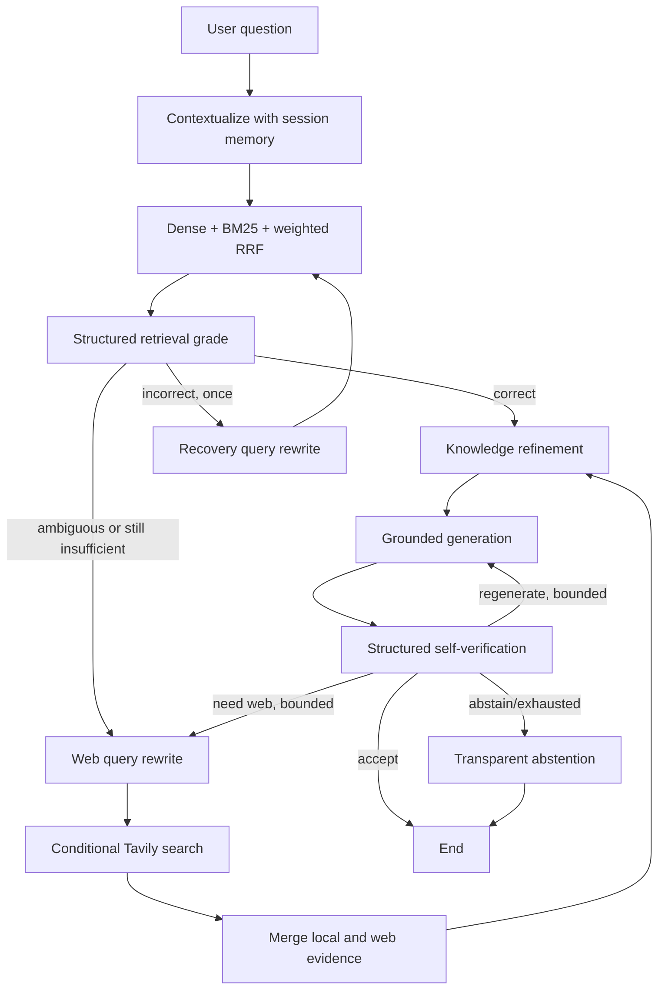

# Adaptive PEFT Research Assistant

This is a research-paper RAG assistant for PEFT/LLM fine-tuning. It keeps the
existing PDF parsing, embedding-token-aware chunking, Qdrant storage, local
HuggingFace embeddings, BM25, and weighted RRF hybrid retrieval. LangGraph is
used only for orchestration: it makes recovery, web fallback, and verification
explicit, bounded, and inspectable.

## Architecture

Baseline RAG was a history-aware LCEL flow: contextualize → hybrid retrieval →
Gemini answer. The compatibility function `src.pipeline.answer_question` now
invokes the following self-reflective orchestration (inspired by Self-RAG, but
not the original trained reflection-token architecture):



`RetrievalGrade` decides whether passages contain answering evidence rather
than merely mentioning a related topic. Its `confidence` is an LLM evidence-
sufficiency signal, not a calibrated probability. `CRAG_CORRECT_THRESHOLD` and
`CRAG_INCORRECT_THRESHOLD` apply only to that evaluator signal—never to an RRF
score. RRF remains a rank-fusion mechanism and its magnitudes are not
confidence values.

For correct local evidence, the graph refines knowledge strips and generates.
For ambiguous evidence it preserves the useful local passages and adds web
evidence. For incorrect evidence it first performs one configurable recovery
retrieval with a PEFT-aware rewritten query; only a still-insufficient result
can route to Tavily. `corpus_only` policy never invokes web search and instead
abstains when the paper corpus is inadequate.

Knowledge refinement splits passages into traceable sentences and batch-selects
only evidence-bearing strips. A strip retains its original paper/page/chunk or
web title/URL metadata. A compact, strongly graded local context can skip this
extra call. The final generator sees only that assembled context and uses local
citations as `[Paper Title, Page X]` and web citations as `[Web: Source Title]`.

After generation, `AnswerGrade` verifies grounding, completeness,
answerability, citations, unsupported claims, and missing information. Citation
checks are also performed programmatically against the sources in graph state.
It can accept, regenerate, request web evidence, or abstain; this is
self-verification/self-reflection, not a claim to implement the original
trained Self-RAG system.

## Safety and configuration

All settings are centralized in `src/config.py` and can be overridden in `.env`:

```dotenv
GEMINI_API_KEY=...
TAVILY_API_KEY=...                 # optional
SOURCE_POLICY=adaptive             # adaptive | corpus_only
CRAG_CANDIDATE_K=12
CRAG_CORRECT_THRESHOLD=0.70
CRAG_INCORRECT_THRESHOLD=0.30
MAX_RETRIEVAL_RETRIES=1
MAX_GENERATION_RETRIES=1
MAX_TOTAL_ITERATIONS=3
TAVILY_MAX_RESULTS=4
```

No credential has a source-code fallback. Missing Tavily credentials leave the
project functional in internal-only mode and create a controlled trace error,
not corrupted state. Every loop is guarded by the retrieval, generation, and
total-iteration counters; exhausted routes prefer transparent abstention.

## Run

1. Create a supported Python environment, install dependencies, and copy
   `env.example` to `.env` with a Gemini key. Tavily is optional.
2. Put PDFs in `data/papers/`, then create/load the index:

   ```powershell
   python -m src.indexing
   ```

3. Start the chat UI:

   ```powershell
   streamlit run app/app.py
   ```

The Streamlit citation panel distinguishes paper versus web evidence. Each
answer also has a concise **Retrieval / Agent Trace** with operational stages
only—never model chain-of-thought.

## Evaluation

```powershell
python -m src.evaluate --no-judge
python -m src.evaluate --modes hybrid
```

Existing Hit@k, Precision@k, Recall@k, MRR, nDCG, faithfulness, relevance,
completeness, citation validity, abstention, latency, and memory probes remain.
The end-to-end report also includes web-trigger and unnecessary-web rates,
retrieval-retry rate/success, verification-pass rate, self-repair and final
abstention rates, average iterations/LLM calls, and local-only/local+web/web-
only answer rates. Use the legacy baseline retrieval mode/previous reports as
the `BASELINE RAG` comparison, the graph with verifier disabled in a controlled
experiment as `CRAG`, and the default graph as `CRAG + SELF-VERIFICATION`.

## Example operational traces

Local-only path:

```text
Query ready for retrieval
Hybrid retrieval returned 12 candidates
Retrieval verdict: CORRECT
Knowledge refinement retained 8 evidence strips
Answer generated (attempt 1)
Self-verification: ACCEPT
```

Corrective web path:

```text
Query contextualized from conversation history
Hybrid retrieval returned 12 candidates
Retrieval verdict: INCORRECT
Retrieval recovery query rewritten
Hybrid retrieval returned 12 candidates
Retrieval verdict: AMBIGUOUS
Web-search query rewritten
Web search added 3 sources
Merged 4 local and 3 web evidence items
Knowledge refinement retained 10 evidence strips
Self-verification: ACCEPT
```

## Trade-offs and limits

The graph adds LLM calls, latency, and (when used) web-search cost. LLM graders
can make mistakes, so they are structured, logged, backed by programmatic
citation validation, and intentionally bounded—not autonomous. Tavily quality
and availability remain external dependencies. BM25 is deliberately in-memory
from the JSONL chunk store, suitable for this paper corpus but not millions of
chunks; a large deployment would use a scalable sparse backend. Embedded
Qdrant also has an exclusive local directory lock, so do not run indexing, the
UI, and evaluation concurrently against it.
